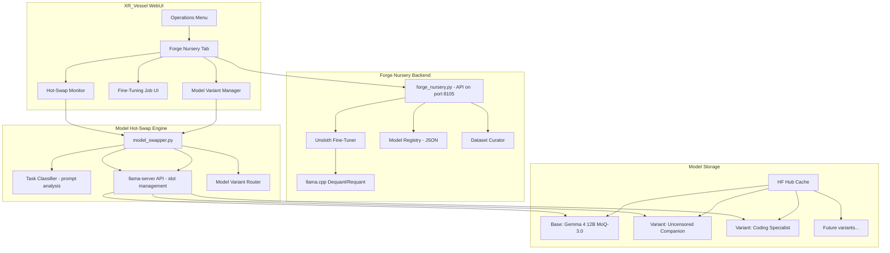
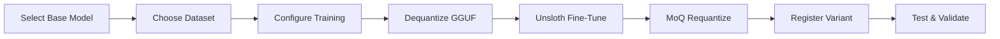

# Forge Nursery — Model Forge & Hot-Swap Architecture

## Vision
A self-contained fine-tuning pipeline (Forge Nursery) that takes Gemma 4 12B as its base, creates specialized fine-tuned variants using Unsloth, and a hot-swap system that automatically selects the right variant for each task — all managed through the XR_Vessel WebUI.

## Architecture Overview



## Phase 1: Model Hot-Swap System

### Goal
Automatically switch between model variants based on the user's task context, without manual intervention.

### Components

#### 1a. Task Classifier (`Forge/nursery/task_classifier.py`)
- Analyzes incoming prompts for task type
- Classification categories:
  - `companion` — emotional, intimate, personal conversation
  - `coding` — code generation, debugging, architecture
  - `creative` — storytelling, writing, artistic
  - `analysis` — research, philosophy, science, debate
- Uses keyword heuristics + optional local LLM quick-classify
- Returns: `{ variant: str, confidence: float, reason: str }`

#### 1b. Model Variant Registry (`Forge/nursery/model_registry.json`)
```json
{
  "variants": {
    "companion": {
      "id": "gemma-4-12b-companion",
      "path": "MoQ-3.0.gguf",
      "mtp": null,
      "context_size": 8192,
      "description": "Default companion - warm, emotionally aware"
    },
    "coding": {
      "id": "gemma-4-12b-coding",
      "path": "MoQ-3.5.gguf",
      "mtp": "mtp-gemma-4-12B-it.gguf",
      "context_size": 8192,
      "description": "Sharp coding/agentic specialist with MTP"
    }
  },
  "default": "companion",
  "hot_swap_enabled": true
}
```

#### 1c. Model Swapper (`Forge/nursery/model_swapper.py`)
- Communicates with llama-server API (`/slots`, `/slots/{id}`)
- On task change: unloads current slot, loads target variant
- Handles graceful fallback if variant unavailable
- Logs all swaps to `.logs/model_swaps.jsonl`

#### 1d. Integration with Soul Service
- Add `LUMAX_MODEL_SWAP_ENABLED=true` to `.env`
- Soul's `lumax_engine.py` calls task classifier before each request
- If classification confidence > threshold, triggers swap
- Adds `X-Lumax-Model-Variant` header to track which model served

### Deliverables (Phase 1)
- [ ] `Forge/nursery/task_classifier.py`
- [ ] `Forge/nursery/model_registry.json`
- [ ] `Forge/nursery/model_swapper.py`
- [ ] `.env` additions for hot-swap config
- [ ] Integration point in `Backend/Cognition/lumax_engine.py`
- [ ] XR_Vessel tab: Hot-Swap Monitor (shows active variant, swap history)

---

## Phase 2: Forge Nursery — Fine-Tuning Pipeline

### Goal
A web-driven pipeline to create specialized Gemma 4 12B variants using Unsloth.

### Pipeline Steps



### Components

#### 2a. Dataset Curator (`Forge/nursery/dataset_curator.py`)
- Searches HuggingFace for relevant datasets
- Pre-configured dataset mappings:
  - **Uncensored Companion**: `cognitivecomputations/dolphin`, abliteration datasets, emotional conversation datasets
  - **Coding Specialist**: `bigcode/the-stack`, `codeparrot/github-code`, instruction-tuning datasets
- Downloads, formats, and caches datasets locally
- Supports custom dataset upload via WebUI

#### 2b. Fine-Tuning Engine (`Forge/nursery/fine_tuner.py`)
- Wraps Unsloth's fine-tuning API
- Configuration:
  - LoRA rank, alpha, dropout
  - Learning rate, epochs, batch size
  - Target modules (all-linear for Gemma)
- Progress tracking with WebSocket updates to WebUI
- Checkpoint saving/resuming
- Output: merged LoRA weights ready for quantization

#### 2c. Quantization Pipeline (`Forge/nursery/quantizer.py`)
- Uses Unsloth's llama.cpp quantize tool
- Dequantize: GGUF → FP16 (for fine-tuning input)
- Requantize: FP16 → MoQ GGUF (for deployment)
- Supports MoQ-3.0, MoQ-3.5, MoQ-4.0 levels
- Validates output model with test inference

#### 2d. Forge Nursery API (`Forge/nursery/forge_nursery_api.py`)
- FastAPI service on port 8105
- Endpoints:
  - `GET /api/variants` — list all variants
  - `POST /api/forge` — start a fine-tuning job
  - `GET /api/forge/{job_id}` — job status
  - `GET /api/datasets` — list available datasets
  - `POST /api/datasets/import` — import custom dataset
  - `DELETE /api/variants/{id}` — remove variant

#### 2e. XR_Vessel WebUI Tab (`Forge Nursery`)
- **Variant Manager**: List, activate, delete variants
- **Forge Job UI**: 
  - Select base model (dropdown)
  - Select dataset (dropdown with search)
  - Configure training params (sliders/inputs)
  - Start/Stop/Monitor jobs
  - Live progress bar via WebSocket
- **Dataset Browser**: Search HF, preview, import

### Deliverables (Phase 2)
- [ ] `Forge/nursery/dataset_curator.py`
- [ ] `Forge/nursery/fine_tuner.py`
- [ ] `Forge/nursery/quantizer.py`
- [ ] `Forge/nursery/forge_nursery_api.py`
- [ ] `Forge/nursery/requirements.txt`
- [ ] XR_Vessel tab: ForgeNurseryTab.ts
- [ ] Sleipnir launcher entry for forge_nursery_api (port 8105)

---

## Phase 3: Embodiment & Haptic Training

### Goal
Fine-tune the companion variant for embodied, haptically-aware interaction.

### Research Areas
- Haptic feedback datasets (pressure, touch, temperature mappings)
- Embodiment frameworks (robot body awareness, proprioception)
- Multimodal training (text + haptic sensor data)
- Integration with existing haptic wand system

### Components (Exploratory)
- `Forge/nursery/embodiment/` — dedicated sub-package
- Haptic data collection pipeline
- Sensor-to-text mapping for training data
- Embodiment prompt templates

### Deliverables (Phase 3)
- [ ] Research document: haptic/embodiment training approaches
- [ ] `Forge/nursery/embodiment/haptic_dataset_builder.py`
- [ ] `Forge/nursery/embodiment/embodiment_trainer.py`
- [ ] Integration with haptic wand hardware

---

## Environment Configuration

### New `.env` entries:
```env
# --- Forge Nursery ---
FORGE_NURSERY_ENABLED=true
FORGE_NURSERY_PORT=8105
FORGE_NURSERY_MODELS_DIR=C:/Users/danie/.cache/huggingface/hub

# --- Model Hot-Swap ---
LUMAX_MODEL_SWAP_ENABLED=true
LUMAX_MODEL_SWAP_THRESHOLD=0.7
LUMAX_MODEL_SWAP_COOLDOWN=30

# --- Variant Paths ---
LUMAX_VARIANT_COMPANION=C:/Users/danie/.cache/huggingface/hub/w-ahmad/Gemma-4-12B-it-qat-GGUF-MoQ/MoQ-3.0.gguf
LUMAX_VARIANT_CODING=C:/Users/danie/.cache/huggingface/hub/w-ahmad/Gemma-4-12B-it-qat-GGUF-MoQ/MoQ-3.5.gguf
LUMAX_VARIANT_CODING_MTP=C:/Users/danie/.cache/huggingface/hub/models--unsloth--gemma-4-12B-it-qat-GGUF/snapshots/7102bdea62863acff919c945405ef29973113d66/mtp-gemma-4-12B-it.gguf
```

---

## Directory Structure

```
Forge/nursery/
├── __init__.py
├── task_classifier.py      # Phase 1
├── model_registry.json     # Phase 1
├── model_swapper.py        # Phase 1
├── dataset_curator.py      # Phase 2
├── fine_tuner.py           # Phase 2
├── quantizer.py            # Phase 2
├── forge_nursery_api.py    # Phase 2
├── requirements.txt        # Phase 2
├── embodiment/             # Phase 3
│   ├── __init__.py
│   ├── haptic_dataset_builder.py
│   └── embodiment_trainer.py
└── datasets/               # Cached training data
    └── .gitkeep
```

## Risk Considerations

1. **VRAM constraints**: Hot-swapping 12B models requires unloading/reloading. The llama-server slot API supports this but adds latency (~30-60s per swap).
2. **Fine-tuning hardware**: Unsloth fine-tuning of 12B models needs significant VRAM. QLoRA 4-bit reduces this but still needs ~16GB+.
3. **Abliteration safety**: Uncensored models need careful prompt boundaries. Consider a content filter layer.
4. **Dataset licensing**: Verify HF dataset licenses before using for fine-tuning.
5. **Model validation**: Each variant must be tested for quality degradation after quantization.