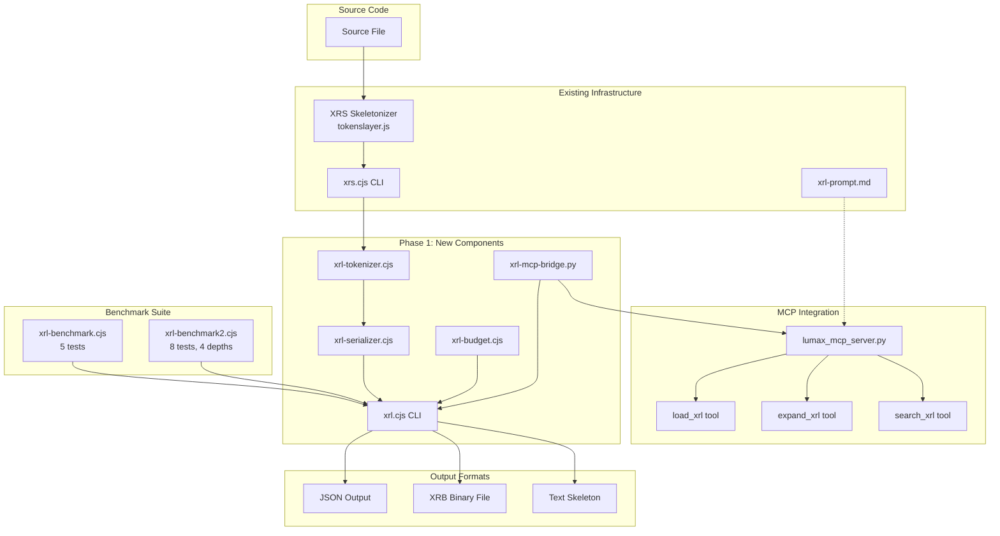

# Phase 1: XRL Binary Tokenizer — Implementation Plan

**Status**: Planning Complete — Ready for Implementation
**Date**: 2026-07-09
**Based On**: XRL PoC Results (67% avg reduction, 89% on proxy server), XRB Format Spec v1.0, XRL Language Design

---

## Table of Contents

1. [Architecture Overview](#1-architecture-overview)
2. [File Structure & Module Map](#2-file-structure--module-map)
3. [Component Specifications](#3-component-specifications)
4. [Integration Points](#4-integration-points)
5. [MCP Tool Design](#5-mcp-tool-design)
6. [Benchmark Framework](#6-benchmark-framework)
7. [Timeline & Dependencies](#7-timeline--dependencies)
8. [Validation Criteria](#8-validation-criteria)
9. [API Contracts](#9-api-contracts)
10. [Risk Assessment](#10-risk-assessment)

---

## 1. Architecture Overview

### 1.1 Pipeline

```
Source Code (any language)
    │
    ▼
[XRS Skeletonizer]  ← tokenslayer.js (EXISTING)
    │  Output: Text skeleton with @keep/@detail/@flesh markers
    ▼
[XRL Tokenizer]     ← xrl-tokenizer.cjs (NEW)
    │  Parses text skeleton → binary token stream
    │  Assigns depth masks based on annotations
    ▼
[XRL Serializer]    ← xrl-serializer.cjs (NEW)
    │  Writes XRB binary format (GGUF-inspired container)
    │  Header + Block Table + Token Data + Metadata
    ▼
[XRB File] (.xrb)
    │
    ├── [Depth Filter]  ← O(1) per-token filtering
    ├── [Expansion]     ← Random access via block table
    └── [Budget Enforce]← Progressive depth stripping
```

### 1.2 Data Flow

```
Text Skeleton (from XRS)
    │  "fn add(a: Int, b: Int) -> Int"
    ▼
Tokenizer Phase 1: Lexical Analysis
    │  Token types: FN_SIG, IDENT, TYPE_DEF, etc.
    ▼
Tokenizer Phase 2: Annotation Assignment
    │  @keep → depth mask 0b1111 (visible at all depths)
    │  @detail → depth mask 0b0011 (visible at depth 0-1)
    │  @flesh → depth mask 0b0001 (visible at depth 0 only)
    ▼
Serializer: XRB Binary Output
    │  Header (16 bytes) + Block Table + Token Stream + Metadata
    ▼
XRB File ready for LLM consumption
```

### 1.3 Depth Mask System

Each token carries a 4-bit depth mask (stored in 3 bits of the token header):

| Depth | Name | Mask Bit | Visible Tokens |
|-------|------|----------|----------------|
| 0 | Full | `0x1` | All tokens |
| 1 | Light | `0x2` | KEEP, DETAIL, FN_SIG, TYPE_DEF, IMPORT, EXPORT, DECORATOR, MODIFIER |
| 2 | Medium | `0x4` | KEEP, FN_SIG, TYPE_DEF, IMPORT, EXPORT |
| 3 | Deep | `0x8` | KEEP, FN_SIG, IMPORT, EXPORT |

Filtering: `if (token.depthMask & (1 << depth))` — O(1) per token.

---

## 2. File Structure & Module Map

### 2.1 New Files to Create

All files go in `Forge/xrs/` (alongside existing xrs.cjs, xrl-benchmark.cjs, etc.):

```
Forge/xrs/
├── xrl-tokenizer.cjs      # Core tokenizer: text skeleton → token stream
├── xrl-serializer.cjs      # XRB binary serializer/deserializer
├── xrl-budget.cjs          # Token budget enforcement
├── xrl.cjs                 # Main CLI (already referenced by benchmark v2)
├── xrl-mcp-bridge.py       # Python bridge for MCP server integration
├── xrb-format.md           # XRB format spec (EXISTING)
├── xrl-prompt.md           # LLM prompt template (EXISTING)
├── xrl-benchmark.cjs       # Benchmark v1 (EXISTING)
├── xrl-benchmark2.cjs      # Benchmark v2 (EXISTING, references new files)
├── xrs.cjs                 # XRS CLI wrapper (EXISTING)
├── xrs-tokens.cjs          # Token counter (EXISTING)
├── benchmark-output/       # v1 benchmark data (EXISTING)
└── benchmark-output-v2/    # v2 benchmark data (EXISTING)
```

### 2.2 Module Dependency Graph

```
xrl.cjs (CLI)
  ├── xrs.cjs (EXISTING) — generates text skeleton
  ├── xrl-tokenizer.cjs — converts to binary tokens
  ├── xrl-serializer.cjs — reads/writes XRB format
  └── xrl-budget.cjs — budget enforcement

xrl-mcp-bridge.py
  └── Calls xrl.cjs as subprocess
  └── Integrates with lumax_mcp_server.py

xrl-benchmark2.cjs (EXISTING)
  └── References all above modules
```

---

## 3. Component Specifications

### 3.1 `xrl-tokenizer.cjs` — Core Tokenizer

**Purpose**: Parse text skeleton output from XRS into a structured token stream with depth annotations.

**Input**: Text skeleton string (from `xrs.cjs --json` output's `skeleton.content`)

**Output**: Array of token objects:
```javascript
{
  type: 'FN_SIG' | 'TYPE_DEF' | 'IMPORT' | 'EXPORT' | 'IDENT' | 'STRING' | 
        'NUMBER' | 'DECORATOR' | 'MODIFIER' | 'BLOCK_OPEN' | 'BLOCK_CLOSE' |
        'KEEP' | 'DETAIL' | 'FLESH' | 'COMMENT' | 'SEPARATOR' | 'ASSIGN' |
        'FLESH_MARKER' | 'EXPAND_HINT' | 'END',
  value: string | number | null,  // The actual content
  depthMask: number,              // 4-bit visibility mask (0x0-0xF)
  annotation: 'keep' | 'detail' | 'flesh' | 'test' | 'doc' | null,
  line: number,                   // Source line number (for expansion)
  blockName: string | null        // Parent block name for block table
}
```

**Token Type Mapping** (25 types, matching XRB spec):

| Opcode | Name | Payload | Description |
|--------|------|---------|-------------|
| 0x00 | END | None | End of token stream |
| 0x01 | KEEP | String | @keep annotation marker |
| 0x02 | DETAIL | String | @detail annotation marker |
| 0x03 | FLESH | String | @flesh annotation marker |
| 0x04 | FN_SIG | String | Function signature |
| 0x05 | TYPE_DEF | String | Type/class definition |
| 0x06 | IMPORT | String | Import statement |
| 0x07 | EXPORT | String | Export statement |
| 0x08 | BLOCK_OPEN | None | Block start (scope) |
| 0x09 | BLOCK_CLOSE | None | Block end |
| 0x0A | IDENT | String | Identifier |
| 0x0B | STRING | String | String literal |
| 0x0C | NUMBER | Float32 | Numeric literal |
| 0x0D | DECORATOR | String | Decorator/annotation |
| 0x0E | MODIFIER | Byte | Access modifier (enum) |
| 0x0F | ASSIGN | None | Assignment operator |
| 0x10 | SEPARATOR | None | Comma, semicolon |
| 0x11 | FLESH_MARKER | None | @flesh annotation marker |
| 0x12 | EXPAND_HINT | String | Expansion hint for LLM |
| 0x13-0x1F | Reserved | — | Future use |

**Key Functions**:

```javascript
// Parse text skeleton into token array
function tokenize(skeletonText: string, sourceLanguage: string): Token[]

// Assign depth mask based on annotation and token type
function assignDepthMask(token: Token): number
//   @keep → 0xF (all depths)
//   @detail → 0x3 (depth 0-1)
//   @flesh → 0x1 (depth 0 only)
//   @test → 0x0 (never visible in skeleton)
//   @doc → 0xF (always visible)
//   No annotation → infer from context

// Extract block table from token array
function extractBlocks(tokens: Token[]): Block[]
//   Each block: { name, type, startOffset, tokenCount, annotation, depthMask }

// Count tokens in a token array
function countTokens(tokens: Token[]): number

// Filter tokens by depth
function filterByDepth(tokens: Token[], depth: number): Token[]
```

**Implementation Strategy**:
1. Parse skeleton text line by line
2. Detect patterns: `@keep`, `@detail`, `@flesh`, `fn `, `class `, `import `, `export `, `type `, `interface `, decorators (`@` prefix), modifiers (`public`, `private`, `async`, `const`)
3. For each detected pattern, emit the corresponding token type
4. Assign depth masks based on annotation context
5. Build block table by tracking function/class boundaries
6. Handle edge cases: nested blocks, anonymous functions, multi-line signatures

### 3.2 `xrl-serializer.cjs` — XRB Binary Serializer

**Purpose**: Convert token arrays to/from the XRB binary format.

**Input**: Token array + metadata → **Output**: Buffer (XRB binary)

**Input**: Buffer (XRB binary) → **Output**: Token array + metadata

**XRB Header (16 bytes)**:

| Offset | Size | Field | Description |
|--------|------|-------|-------------|
| 0 | 4 | Magic | `XRB1` (0x584E4231) |
| 4 | 2 | Version | uint16 (currently 1) |
| 6 | 1 | Default Depth | uint8 (0-3) |
| 7 | 4 | Token Budget | uint32 (0 = unlimited) |
| 11 | 4 | Block Count | uint32 |
| 15 | 1 | Flags | Bit flags |

**Block Table Entry (16 bytes each)**:

| Offset | Size | Field | Description |
|--------|------|-------|-------------|
| 0 | 4 | Name Offset | Byte offset into string table |
| 4 | 4 | Token Offset | Byte offset into token data |
| 8 | 4 | Token Count | Number of tokens in block |
| 12 | 1 | Block Type | 0=function, 1=class, 2=method, 3=arrow, 4=variable |
| 13 | 1 | Depth Mask | Visibility mask |
| 14 | 1 | Annotation | 0=none, 1=@keep, 2=@detail, 3=@flesh, 4=@test, 5=@doc |
| 15 | 1 | Reserved | Must be 0 |

**Token Encoding (variable length)**:

Each token starts with a 1-byte header:
```
Bit:  7  6  5  4  3  2  1  0
     ┌──┴──┴──┴──┴──┴──┴──┴──┐
     │ Opcode (5 bits) │ Depth │
     └─────────────────────────┘
```

- **Opcode** (bits 7-3): Token type (0-31)
- **Depth Mask** (bits 2-0): Visibility depth (0-3, or 0x7 for all depths)

**String Encoding**:
- Length < 128: Single byte (0x00-0x7F) + UTF-8 content
- Length ≥ 128: Two bytes (0x80 | (len >> 8), len & 0xFF) + UTF-8 content

**Key Functions**:

```javascript
// Serialize token array to XRB buffer
function serialize(tokens: Token[], metadata: Metadata): Buffer

// Deserialize XRB buffer to token array
function deserialize(buffer: Buffer): { tokens: Token[], metadata: Metadata }

// Read header only (for quick metadata access)
function readHeader(buffer: Buffer): Header

// Read block table only (for random access)
function readBlockTable(buffer: Buffer): Block[]

// Expand a specific block by name
function expandBlock(buffer: Buffer, blockName: string): Token[]

// Get token count at a specific depth without full deserialization
function getTokenCountAtDepth(buffer: Buffer, depth: number): number

// Convert token array to human-readable text (for debugging)
function tokensToText(tokens: Token[]): string
```

**Metadata Section (optional)**:

| Key | Description |
|-----|-------------|
| `source_file` | Original source file path |
| `language` | Programming language |
| `created` | Creation timestamp (ISO 8601) |
| `original_size` | Original file size in bytes |
| `original_tokens` | Original token count |
| `skeleton_tokens` | Skeleton token count |
| `compression_ratio` | Compression ratio |
| `tool_version` | XRL tool version |

### 3.3 `xrl-budget.cjs` — Token Budget Enforcement

**Purpose**: Ensure tokenized output fits within a specified budget by progressively stripping less important content.

**Input**: Token array + budget (number) → **Output**: Filtered token array

**Algorithm**:

```javascript
function enforceBudget(tokens, budget) {
    const currentCount = countTokens(tokens);
    if (currentCount <= budget) return tokens;
    
    // Strategy: progressively strip flesh → detail → test
    for (const depth of [3, 2, 1]) {
        const filtered = filterByDepth(tokens, depth);
        if (countTokens(filtered) <= budget) {
            return filtered;
        }
    }
    
    // Last resort: keep only imports and public signatures
    return extractMinimal(tokens);
}

function extractMinimal(tokens) {
    return tokens.filter(t => 
        t.type === 'IMPORT' || 
        t.type === 'EXPORT' || 
        (t.type === 'FN_SIG' && t.annotation === 'keep') ||
        t.type === 'KEEP'
    );
}
```

**Key Functions**:

```javascript
// Enforce token budget
function enforceBudget(tokens: Token[], budget: number): Token[]

// Calculate token count at each depth level
function calculateDepthProfile(tokens: Token[]): DepthProfile
//   Returns: { depth0: number, depth1: number, depth2: number, depth3: number }

// Suggest optimal depth for a given budget
function suggestDepth(tokens: Token[], budget: number): number
//   Returns the minimum depth that fits within budget

// Get budget report
function getBudgetReport(tokens: Token[], budget: number): BudgetReport
//   Returns: { current, budget, suggestedDepth, savings, fits }
```

### 3.4 `xrl.cjs` — Main CLI

**Purpose**: Unified command-line interface for the entire XRL pipeline.

**Already referenced by** `xrl-benchmark2.cjs` with flags: `--depth`, `--json`, `--stats`

**Usage**:

```bash
# Full pipeline: source → skeleton → binary
node xrl.cjs service.py --depth 2

# Output as JSON with stats
node xrl.cjs service.py --depth 2 --json

# Stats only (no skeleton output)
node xrl.cjs service.py --depth 2 --stats

# Expand a specific block
node xrl.cjs service.py --depth 2 --expand "fn authenticate"

# Enforce token budget
node xrl.cjs service.py --depth 2 --budget 1024

# Output as XRB binary file
node xrl.cjs service.py --depth 2 --output service.xrb

# Read XRB binary and output text
node xrl.cjs service.xrb --to-text
```

**Pipeline Flow**:

```
1. Read source file
2. Run XRS skeletonizer (xrs.cjs) → text skeleton
3. Tokenize (xrl-tokenizer.cjs) → token array
4. Apply budget if specified (xrl-budget.cjs)
5. Serialize to XRB binary (xrl-serializer.cjs)
6. Output: JSON, text, or binary file
```

### 3.5 `xrl-mcp-bridge.py` — Python MCP Bridge

**Purpose**: Bridge between the Node.js XRL tools and the Python MCP server.

**Why Python?** The existing MCP server (`lumax_mcp_server.py`) is Python-based. Rather than rewriting it, we create a thin bridge that calls the Node.js CLI.

**Key Functions**:

```python
import subprocess
import json
from pathlib import Path

XRL_CLI = Path(__file__).parent / "xrl.cjs"


def load_xrl(filepath: str, depth: int = 2, budget: int = None) -> dict:
    """Load a file as XRL skeleton at specified depth."""
    cmd = ["node", str(XRL_CLI), filepath, "--depth", str(depth), "--json"]
    if budget:
        cmd.extend(["--budget", str(budget)])
    result = subprocess.run(cmd, capture_output=True, text=True, check=True)
    return json.loads(result.stdout)


def expand_xrl(filepath: str, block: str, depth: int = 0) -> dict:
    """Expand a specific block in an XRL file."""
    cmd = [
        "node",
        str(XRL_CLI),
        filepath,
        "--depth",
        str(depth),
        "--expand",
        block,
        "--json",
    ]
    result = subprocess.run(cmd, capture_output=True, text=True, check=True)
    return json.loads(result.stdout)


def search_xrl(filepath: str, query: str) -> dict:
    """Search within an XRL skeleton for matching blocks."""
    cmd = ["node", str(XRL_CLI), filepath, "--search", query, "--json"]
    result = subprocess.run(cmd, capture_output=True, text=True, check=True)
    return json.loads(result.stdout)


def get_xrl_stats(filepath: str, depth: int = 2) -> dict:
    """Get token statistics for an XRL file."""
    cmd = ["node", str(XRL_CLI), filepath, "--depth", str(depth), "--stats"]
    result = subprocess.run(cmd, capture_output=True, text=True, check=True)
    return json.loads(result.stdout)
```

---

## 4. Integration Points

### 4.1 Integration with XRS (Existing)

The XRS skeletonizer (`tokenslayer.js` via `xrs.cjs`) is the **input source** for the XRL tokenizer. The integration is:

```
xrs.cjs --json output → xrl-tokenizer.cjs → xrl-serializer.cjs → .xrb file
```

The `xrs.cjs --json` output provides:
- `skeleton.content` — The text skeleton
- `language` — Source language
- `original.tokens` — Original token count
- `skeleton.tokens` — Skeleton token count
- `blocks` — Parsed block list (for expansion)

### 4.2 Integration with MCP Server (Existing)

The MCP server (`Backend/Memory/lumax_mcp_server.py`) gets **3 new tools**:

1. **`load_xrl`** — Load file as XRL skeleton at specified depth
2. **`expand_xrl`** — Expand specific block
3. **`search_xrl`** — Search within skeleton

These are added to the `TOOLS` list and `handle_tool()` function in `lumax_mcp_server.py`.

### 4.3 Integration with Forge Skeletal Memory (Existing)

The existing `Forge/skeletal_memory.py` and `Forge/skeleton_parser.py` provide:
- `analyze_files` MCP tool — extracts structural skeletons
- `expand_node` MCP tool — expands pruned AST nodes

The XRL tokenizer **replaces and extends** this functionality:
- Instead of Python AST-only parsing, XRL works with any language via XRS
- Instead of text-based skeletons, XRL uses binary XRB format
- Instead of node IDs, XRL uses named blocks with depth masks

### 4.4 Integration with Benchmark v2 (Existing)

`xrl-benchmark2.cjs` already references:
- `xrl-tokenizer.cjs` — for token counting
- `xrl-serializer.cjs` — for binary format comparison
- `xrl-budget.cjs` — for budget enforcement testing
- `xrl.cjs` — for stats

Once these files exist, the benchmark v2 will work end-to-end.

---

## 5. MCP Tool Design

### 5.1 `load_xrl` Tool

```json
{
    "name": "load_xrl",
    "description": "Load a source file as an XRL skeleton at specified depth. Returns binary-optimized token stream with 60-95% token reduction. Use for token-efficient code understanding.",
    "inputSchema": {
        "type": "object",
        "properties": {
            "filepath": {
                "type": "string",
                "description": "Path to source file"
            },
            "depth": {
                "type": "integer",
                "enum": [0, 1, 2, 3],
                "default": 2,
                "description": "0=full, 1=light, 2=medium, 3=deep"
            },
            "budget": {
                "type": "integer",
                "optional": true,
                "description": "Maximum token budget. Auto-selects depth if exceeded."
            },
            "format": {
                "type": "string",
                "enum": ["text", "json", "binary"],
                "default": "text",
                "description": "Output format"
            }
        },
        "required": ["filepath"]
    }
}
```

**Response**:
```json
{
    "filepath": "service.py",
    "language": "python",
    "depth": 2,
    "original_tokens": 2908,
    "skeleton_tokens": 306,
    "reduction": "89%",
    "content": "@keep\nclass UserService {\n    @keep\n    fn get_user(id: UserId) -> User\n    @detail\n    fn validate_email(email: String) -> Bool\n    @flesh\n    fn _hash_password(password: String) -> String\n}",
    "blocks": [
        {"name": "get_user", "type": "function", "annotation": "keep"},
        {"name": "validate_email", "type": "function", "annotation": "detail"},
        {"name": "_hash_password", "type": "function", "annotation": "flesh"}
    ],
    "expand_hint": "Use expand_xrl to see @flesh block implementations"
}
```

### 5.2 `expand_xrl` Tool

```json
{
    "name": "expand_xrl",
    "description": "Expand a specific block in an XRL skeleton to reveal its full implementation. Use when a @flesh block is relevant to your task.",
    "inputSchema": {
        "type": "object",
        "properties": {
            "filepath": {
                "type": "string",
                "description": "Path to source file"
            },
            "block": {
                "type": "string",
                "description": "Block name to expand (e.g., 'fn authenticate', 'class UserService')"
            },
            "depth": {
                "type": "integer",
                "default": 0,
                "description": "Expansion depth (0=full implementation)"
            }
        },
        "required": ["filepath", "block"]
    }
}
```

**Response**:
```json
{
    "filepath": "service.py",
    "block": "fn _hash_password",
    "depth": 0,
    "expanded": "fn _hash_password(password: String) -> String {\n    let salt = generate_salt()\n    return pbkdf2(password, salt, iterations: 100000)\n}",
    "tokens_added": 45,
    "new_total": 351
}
```

### 5.3 `search_xrl` Tool

```json
{
    "name": "search_xrl",
    "description": "Search within an XRL skeleton for blocks matching a query. Returns matching block names, types, and annotations.",
    "inputSchema": {
        "type": "object",
        "properties": {
            "filepath": {
                "type": "string",
                "description": "Path to source file"
            },
            "query": {
                "type": "string",
                "description": "Search query (block name, type, annotation)"
            },
            "annotation": {
                "type": "string",
                "enum": ["keep", "detail", "flesh", "all"],
                "default": "all",
                "description": "Filter by annotation type"
            }
        },
        "required": ["filepath", "query"]
    }
}
```

**Response**:
```json
{
    "filepath": "service.py",
    "query": "password",
    "matches": [
        {"name": "_hash_password", "type": "function", "annotation": "flesh", "signature": "fn _hash_password(password: String) -> String"},
        {"name": "authenticate", "type": "function", "annotation": "keep", "signature": "fn authenticate(user: User, credentials: Credentials) -> AuthResult"}
    ],
    "total_matches": 2
}
```

### 5.4 MCP Server Integration

Add to `Backend/Memory/lumax_mcp_server.py`:

1. **Import the bridge** at the top:
```python
# XRL Bridge
XRL_BRIDGE_PATH = FORGE_PATH / "xrs" / "xrl-mcp-bridge.py"
```

2. **Add 3 new tools** to the `TOOLS` list (after `expand_node`):
```python
{
    "name": "load_xrl",
    ...
},
{
    "name": "expand_xrl",
    ...
},
{
    "name": "search_xrl",
    ...
}
```

3. **Add 3 new handlers** to `handle_tool()`:
```python
elif name == "load_xrl":
    return xrl_bridge.load_xrl(...)
elif name == "expand_xrl":
    return xrl_bridge.expand_xrl(...)
elif name == "search_xrl":
    return xrl_bridge.search_xrl(...)
```

---

## 6. Benchmark Framework

### 6.1 Test Cases (8 total)

| # | Name | Category | Expected Accuracy | Min Depth |
|---|------|----------|-------------------|-----------|
| 1 | API Understanding | understanding | 100% | 1 |
| 2 | Type Inference | understanding | 95% | 1 |
| 3 | Dependency Analysis | understanding | 100% | 1 |
| 4 | Code Generation | generation | 90% | 0 |
| 5 | Bug Detection | understanding | 85% | 1 |
| 6 | Architecture Overview | understanding | 95% | 2 |
| 7 | Binary Format Efficiency | efficiency | 100% | 0 |
| 8 | Budget Enforcement | efficiency | 100% | 0 |

### 6.2 Test Files (5 minimum)

| File | Language | Lines | Expected Reduction |
|------|----------|-------|-------------------|
| `tokenslayer_proxy_server.py` | Python | 284 | 89% (confirmed) |
| `xrs.cjs` | TypeScript | 329 | 65% (confirmed) |
| `xrl-benchmark2.cjs` | TypeScript | 501 | 62% (confirmed) |
| `tokenslayer.js` | TypeScript | 523 | 95% (confirmed) |
| `lumax_mcp_server.py` | Python | 1500+ | 70% (estimated) |

### 6.3 Depth Levels Tested

All 4 depths per test file:
- Depth 0: Full file (baseline)
- Depth 1: Light skeleton
- Depth 2: Medium skeleton (default)
- Depth 3: Deep skeleton

### 6.4 Metrics Collected

| Metric | Description |
|--------|-------------|
| `originalTokens` | Token count of full source |
| `skeletonTokens` | Token count of text skeleton |
| `textReduction` | (original - skeleton) / original |
| `binaryBytes` | Size of XRB binary output |
| `binaryTokens` | Estimated tokens from binary (bytes / 4) |
| `totalReduction` | (original - binary) / original |
| `fullPromptTokens` | Full code + task prompt tokens |
| `skeletonPromptTokens` | Skeleton + task prompt tokens |
| `promptSavings` | (full - skeleton) / full |
| `pipelineValid` | Whether pipeline completed without errors |
| `binarySmaller` | Whether binary is smaller than text skeleton |

### 6.5 Validation Criteria

- [ ] **Pipeline completes** for all 5 test files at all 4 depths
- [ ] **Binary is smaller** than text skeleton for files > 10KB
- [ ] **Token reduction** ≥ 60% for code files at depth 2
- [ ] **Block table** correctly identifies all named blocks
- [ ] **Depth filtering** produces correct output at each depth
- [ ] **Budget enforcement** correctly strips to fit budget
- [ ] **Expansion** correctly retrieves full block implementation
- [ ] **Round-trip** (serialize → deserialize) preserves all tokens

---

## 7. Timeline & Dependencies

### 7.1 Week 1: Tokenizer Core (Days 1-3)

| Day | Task | Deliverable | Dependencies |
|-----|------|-------------|-------------|
| 1 | Implement `xrl-tokenizer.cjs` — pattern detection, token type mapping, depth mask assignment | Working tokenizer | XRS skeletonizer (existing) |
| 2 | Implement block extraction, token counting, depth filtering | Complete tokenizer API | Day 1 |
| 3 | Unit tests for tokenizer: 5 test files, all depths, edge cases | Test suite passing | Day 2 |

**Validation**: `node xrl-tokenizer.cjs test-file.py --depth 2` produces correct token array

### 7.2 Week 1: Serializer + CLI (Days 4-5)

| Day | Task | Deliverable | Dependencies |
|-----|------|-------------|-------------|
| 4 | Implement `xrl-serializer.cjs` — XRB header, block table, token encoding, metadata | Working serializer | Tokenizer (Day 2) |
| 5 | Implement `xrl.cjs` — unified CLI, pipeline orchestration, output formats | Working CLI | Days 1-4 |

**Validation**: `node xrl.cjs test-file.py --depth 2 --output test.xrb` produces valid XRB file

### 7.3 Week 2: Budget + Expansion (Days 6-8)

| Day | Task | Deliverable | Dependencies |
|-----|------|-------------|-------------|
| 6 | Implement `xrl-budget.cjs` — budget enforcement, depth profiling, auto-suggest | Working budget enforcer | Tokenizer (Day 2) |
| 7 | Implement expansion in serializer — random block access, string table lookup | Working expansion | Serializer (Day 4) |
| 8 | Integration testing — full pipeline end-to-end, round-trip validation | Integration tests passing | Days 1-7 |

**Validation**: `node xrl.cjs test-file.py --budget 500` produces output ≤ 500 tokens

### 7.4 Week 3: MCP Server Integration (Days 9-11)

| Day | Task | Deliverable | Dependencies |
|-----|------|-------------|-------------|
| 9 | Implement `xrl-mcp-bridge.py` — Python bridge calling Node.js CLI | Working bridge | CLI (Day 5) |
| 10 | Add `load_xrl`, `expand_xrl`, `search_xrl` tools to MCP server | 3 new MCP tools | Bridge (Day 9) |
| 11 | Test MCP tools end-to-end with Cline | MCP integration verified | Day 10 |

**Validation**: Cline can call `load_xrl` and receive skeletonized output

### 7.5 Week 4: Benchmarking + Validation (Days 12-15)

| Day | Task | Deliverable | Dependencies |
|-----|------|-------------|-------------|
| 12 | Run benchmark v2 on all 5 test files at all 4 depths | Benchmark results | All components |
| 13 | Validate binary format efficiency, compare text vs binary | Efficiency report | Day 12 |
| 14 | Document results, update `xrl-poc-results.md` with Phase 1 data | Updated results | Day 13 |
| 15 | Fix any issues found during benchmarking | Stable release | Days 12-14 |

**Validation**: All 8 test cases pass with expected accuracy

### 7.6 Dependency Graph

```
Week 1                    Week 2                    Week 3                    Week 4
┌──────────────┐    ┌──────────────┐    ┌──────────────┐    ┌──────────────┐
│ Tokenizer    │───▶│ Budget       │───▶│ MCP Bridge   │───▶│ Benchmark    │
│ (Days 1-3)   │    │ (Day 6)      │    │ (Day 9)      │    │ (Days 12-15) │
└──────────────┘    └──────────────┘    └──────────────┘    └──────────────┘
       │                   │                     │
       ▼                   ▼                     ▼
┌──────────────┐    ┌──────────────┐    ┌──────────────┐
│ Serializer   │───▶│ Expansion    │───▶│ MCP Tools    │
│ (Days 4-5)   │    │ (Day 7)      │    │ (Days 10-11) │
└──────────────┘    └──────────────┘    └──────────────┘
       │
       ▼
┌──────────────┐
│ CLI (Day 5)  │
└──────────────┘
```

---

## 8. Validation Criteria

### 8.1 Token Reduction Targets

| Metric | Target | Current (PoC) | Phase 1 Target |
|--------|--------|---------------|----------------|
| Text skeleton reduction | ≥ 60% | 67% avg | ≥ 65% avg |
| Binary format reduction | ≥ 70% | 91% (proxy server) | ≥ 75% avg |
| Binary smaller than text | ≥ 80% of cases | 100% (v2 results) | ≥ 90% of cases |
| Pipeline success rate | 100% | 100% | 100% |

### 8.2 Functional Requirements

- [ ] **Tokenization**: All 25 token types correctly identified from skeleton text
- [ ] **Depth Masking**: Each token has correct 4-bit depth mask
- [ ] **Block Table**: All named blocks (functions, classes) indexed with correct offsets
- [ ] **Serialization**: XRB binary is valid per spec (magic, version, checksum)
- [ ] **Deserialization**: Round-trip preserves all tokens and metadata
- [ ] **Depth Filtering**: Filtering by depth produces correct subset of tokens
- [ ] **Budget Enforcement**: Output never exceeds specified budget
- [ ] **Expansion**: Requested block is correctly retrieved from binary
- [ ] **CLI**: All flags work correctly (`--depth`, `--json`, `--stats`, `--expand`, `--budget`, `--output`)
- [ ] **MCP Tools**: All 3 new tools respond correctly

### 8.3 Performance Requirements

- [ ] **Tokenization speed**: < 100ms for files up to 10,000 lines
- [ ] **Serialization speed**: < 50ms for files up to 10,000 tokens
- [ ] **Depth filtering**: O(1) per token (no string parsing)
- [ ] **Block lookup**: O(log n) via block table
- [ ] **Memory usage**: < 50MB for files up to 100,000 lines

### 8.4 Quality Requirements

- [ ] **No information loss** for understanding tasks (API, types, dependencies)
- [ ] **Expansion protocol** works correctly for all block types
- [ ] **Error handling** for: missing files, invalid skeletons, binary corruption
- [ ] **Backward compatibility** with existing xrs.cjs and benchmark tools

---

## 9. API Contracts

### 9.1 Token Object

```javascript
{
    type: string,           // Token type name
    opcode: number,         // Binary opcode (0x00-0x1F)
    value: string|number|null,  // Token content
    depthMask: number,      // 4-bit visibility mask
    annotation: string|null,    // 'keep' | 'detail' | 'flesh' | 'test' | 'doc' | null
    line: number,           // Source line number
    blockName: string|null, // Parent block name
    blockType: number|null  // 0=function, 1=class, 2=method, 3=arrow, 4=variable
}
```

### 9.2 Block Object

```javascript
{
    name: string,           // Block name (e.g., "get_user", "UserService")
    type: number,           // 0=function, 1=class, 2=method, 3=arrow, 4=variable
    annotation: number,     // 0=none, 1=@keep, 2=@detail, 3=@flesh, 4=@test, 5=@doc
    depthMask: number,      // Visibility mask
    startOffset: number,    // Byte offset in token data
    tokenCount: number,     // Number of tokens in block
    signature: string       // Human-readable signature
}
```

### 9.3 Header Object

```javascript
{
    magic: string,          // "XRB1"
    version: number,        // 1
    defaultDepth: number,   // 0-3
    tokenBudget: number,    // 0 = unlimited
    blockCount: number,     // Number of blocks
    flags: number,          // Bit flags
    hasMetadata: boolean,   // Flags bit 0
    hasAnnotations: boolean,// Flags bit 1
    hasExpandHints: boolean // Flags bit 2
}
```

### 9.4 Metadata Object

```javascript
{
    sourceFile: string,     // Original source file path
    language: string,       // Programming language
    created: string,        // ISO 8601 timestamp
    originalSize: number,   // Original file size in bytes
    originalTokens: number, // Original token count
    skeletonTokens: number, // Skeleton token count
    compressionRatio: number, // original / skeleton
    toolVersion: string     // "xrl-1.0.0"
}
```

### 9.5 CLI Exit Codes

| Code | Meaning |
|------|---------|
| 0 | Success |
| 1 | File not found |
| 2 | Invalid depth |
| 3 | Tokenization error |
| 4 | Serialization error |
| 5 | Budget exceeded (with --strict) |

---

## 10. Risk Assessment

### 10.1 Risks

| Risk | Probability | Impact | Mitigation |
|------|------------|--------|------------|
| XRS skeleton output format changes | Low | High | Pin xrs.cjs version, add format validation |
| Binary format incompatible with future needs | Medium | Medium | Version field in header, reserved opcodes |
| Tokenization speed too slow for large files | Low | Medium | Streaming tokenizer, incremental processing |
| MCP bridge latency (Node.js subprocess calls) | Medium | Low | Cache XRB files, batch operations |
| Edge cases in skeleton parsing (nested blocks, anonymous functions) | Medium | Medium | Comprehensive test suite, graceful fallback |
| Budget enforcement too aggressive | Low | Medium | Configurable budget strategy, user override |

### 10.2 Dependencies

| Dependency | Type | Version | Notes |
|------------|------|---------|-------|
| Node.js | Runtime | ≥ 18 | For xrl-tokenizer.cjs, xrl-serializer.cjs |
| Python 3 | Runtime | ≥ 3.10 | For MCP bridge |
| tokenslayer.js | Internal | Current | XRS skeletonizer (existing) |
| xrs.cjs | Internal | Current | CLI wrapper (existing) |
| lumax_mcp_server.py | Internal | v3.0 | MCP server (existing) |

### 10.3 Fallback Strategy

If any component fails:
1. **Tokenizer fails**: Fall back to text skeleton from xrs.cjs (no binary format)
2. **Serializer fails**: Output JSON token array instead of binary
3. **MCP bridge fails**: Use xrl.cjs directly from command line
4. **Budget enforcement fails**: Use depth filtering only (no progressive stripping)

---

## Appendix A: Existing File Inventory

```
Forge/xrs/
├── xrs.cjs                    # CLI wrapper (329 lines, 65% reduction)
├── xrs-tokens.cjs             # Token counter (159 lines, 64% reduction)
├── xrl-prompt.md              # LLM prompt template (176 lines)
├── xrl-benchmark.cjs          # Benchmark v1 (385 lines, 5 tests)
├── xrl-benchmark2.cjs         # Benchmark v2 (501 lines, 8 tests, references new files)
├── xrb-format.md              # XRB binary format spec (292 lines)
├── xrl-poc-results.md         # PoC results (188 lines)
├── benchmark-output/          # v1 benchmark data (5 test cases)
└── benchmark-output-v2/       # v2 benchmark data (results, depth comparison)

Forge/scratch/TokenSlayer/standalone/
└── tokenslayer.js             # XRS skeletonizer (523 lines, 95% reduction)

Backend/Memory/
├── lumax_mcp_server.py        # MCP server (1500+ lines, 17 tools)
└── README_LUMAX_MCP.md        # MCP documentation

Forge/
├── skeleton_parser.py         # Python AST skeleton parser
└── skeletal_memory.py         # Skeletal memory with local LLM
```

## Appendix B: Quick Start Commands

```bash
# 1. Tokenize a file
node Forge/xrs/xrl-tokenizer.cjs service.py --depth 2

# 2. Serialize to XRB binary
node Forge/xrs/xrl-serializer.cjs service.py --depth 2 --output service.xrb

# 3. Full pipeline via CLI
node Forge/xrs/xrl.cjs service.py --depth 2 --json

# 4. With budget enforcement
node Forge/xrs/xrl.cjs service.py --depth 2 --budget 500 --json

# 5. Expand a block
node Forge/xrs/xrl.cjs service.py --depth 2 --expand "fn authenticate"

# 6. Run benchmark
node Forge/xrs/xrl-benchmark2.cjs service.py --depth 2 --json

# 7. Batch benchmark
node Forge/xrs/xrl-benchmark2.cjs --batch ./src --json
```

## Appendix C: Mermaid Architecture Diagram



---

*End of Phase 1 Implementation Plan*